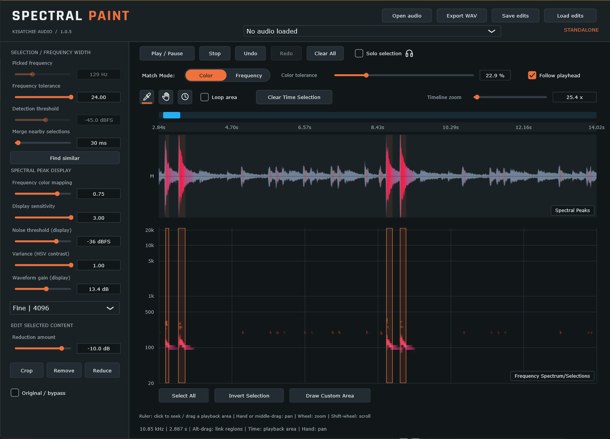

# Spectral Paint — Kisatchie Audio

Windows x64 standalone audio editor and ARA-enabled VST3.

## Linked-selection resizing update — November 15, 2026

A tested Windows maintenance build of **1.0.9** fixes linked-region resizing: resizing a larger time/frequency selection is no longer limited by the shortest or narrowest region in the group. Regions that collapse to zero size are removed when you release the mouse. The change remains undoable as a single step.

The **four-item updated ZIP** has been prepared, containing only **Spectral Paint.exe**, the complete **Spectral Paint.vst3** folder, the illustrated **PDF manual**, and **README.txt** (installation and licensing). Its SHA-256 checksum is `d0113e065b2196069032872a1b12d3e8e0c1cb10caacd56ffb0f5a4c7862e366`.

**Publication status:** the tested maintenance ZIP is not yet available as a public GitHub release asset. The public download below remains the earlier **1.0.9 release without this resizing fix**. Repository collaborators can inspect the [successful Windows build and tests](https://github.com/Quiescent18/spectral-paint/actions/runs/43737739650); that workflow's artifact is not the trimmed four-item ZIP.

## Download Windows Application + VST3 (previous public build)

[Download Spectral Paint 1.0.9 (previous public Windows build)](https://github.com/Quiescent18/spectral-paint-downloads/releases/download/v1.0.9/SpectralPaint-1.0.9-Windows-App-and-VST3-x64.zip)

The currently published Windows ZIP contains **Spectral Paint.exe**, the complete **Spectral Paint.vst3** bundle, the illustrated user manual, demo audio, installation notes and license notices. Use this ZIP to install the application and plug-in. GitHub's separate **Source code** archives contain repository files.

Extract the whole ZIP. Close your DAW before replacing the entire VST3 bundle in a scanned VST3 folder, typically `C:\Program Files\Common Files\VST3`. Enable ARA source access in an ARA-capable DAW. For standalone use, launch **Spectral Paint.exe** and choose your audio device. Verify **1.0.9** in the application or plug-in header.

## User manual and release files

- [Illustrated user manual](https://github.com/Quiescent18/spectral-paint-downloads/releases/download/v1.0.9/SpectralPaint-1.0.9-Users-Manual.pdf)
- [What's new](https://github.com/Quiescent18/spectral-paint-downloads/releases/download/v1.0.9/WHATS-NEW-1.0.9.txt)
- [SHA-256 checksums](https://github.com/Quiescent18/spectral-paint-downloads/releases/download/v1.0.9/SHA256SUMS.txt)
- [Release page](https://github.com/Quiescent18/spectral-paint-downloads/releases/tag/v1.0.9)

Manual page 6 explains linked selections and Alt-drag grouping; page 7 explains Invert Selection; page 9 explains visual playback synchronization; page 12 contains the illustrated color-matching example; page 14 lists shortcuts.

## New in 1.0.9

**Playback Offset** above Follow playhead lets you synchronize the visual playheads and following view with the sound. New VST3 instances default to **−500 ms**; standalone defaults to **0 ms**. Saved offsets, including an explicit zero, are preserved. Set an existing instance to −500 ms manually if needed and save the DAW project.

Drag left/negative to delay the visualizers, or right/positive to advance them. Enter an exact value from −5000 to +5000 ms; double-click the slider to reset to zero. Audio, spectral selections, actual transport timing and exports are unchanged.

This release also includes Invert Selection, Full spectrum as the initial frequency-tolerance setting, a 60 Hz playhead display, and the updated illustrated manual.

## Features

- Color and Frequency matching across source audio.
- Colored waveform and frequency spectrum with editable time/frequency areas.
- Select All, Invert Selection, custom areas and linked selection editing.
- Alt-left-drag in either visualizer toggles touched areas in the linked group; Hand mode remains active for panning.
- Remove, Reduce and Crop spectral audio edits.
- Solo audition, original comparison, Undo/Redo, transport and looping.
- Timeline zoom, pan, playhead following and adjustable visual Playback Offset.
- Save edit decisions and export processed WAV audio.

Audio timing and duration are preserved. Color matching is not instrument recognition or guaranteed source separation. The software edits existing source audio; a host must support ARA source access for plug-in editing.

## Download verification

Compare downloads against **SHA256SUMS.txt**. The Windows binaries passed the core and native integration tests. The binaries are unsigned; Kisatchie Audio file metadata is not a digital signing certificate. Retain the supplied license notices. Third-party components retain their own terms.
